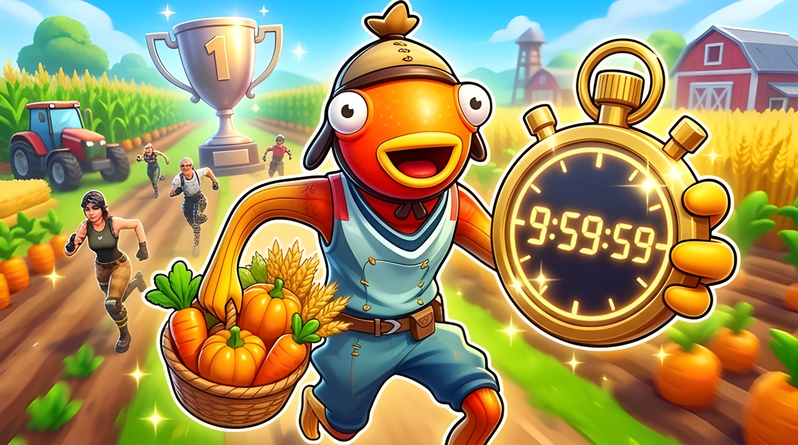

# Rush Valley

A farming speedrun island for Fortnite, built with UEFN and scripted in Verse.
**Published and playable: island code `1562-8418-5645`.**

## The game

Unlock all 7 trophies as fast as you can. Gold under 16:00, silver under 20:00,
bronze under 25:00.

Ten tutorial quests take the player from a single vegetable patch to a full
production chain: harvest, upgrade the garden, unlock the forest and hire a
lumberjack, open the stone and metal mines, automate with bots, upgrade the
base, and hold the farm against waves of zombies. Every unlock costs gold, so
the run is a constant trade-off between investing in production and buying
trophies.

## Under the hood

The game logic is written in Verse as Fortnite creative devices
([`verse/`](verse), about 3,300 lines):

| Script | Role |
|---|---|
| [`Growth_basic.verse`](verse/Growth_basic.verse) | Plant growth, harvest, crop-yield upgrades and garden levels |
| [`plot_manager_device.verse`](verse/plot_manager_device.verse) | Unlocking and planting garden plots |
| [`farm_zone_system.verse`](verse/farm_zone_system.verse) | Resource zones (forest, mines) and the bots that automate them |
| [`base_upgrade_manager.verse`](verse/base_upgrade_manager.verse) | Base levels and the zones each level unlocks |
| [`wave_manager.verse`](verse/wave_manager.verse) | Zombie waves: spawning from a pool, chasing and attacking the player |
| [`quest_manager.verse`](verse/quest_manager.verse) | The 10-step tutorial quest chain, with markers and rewards |
| [`trophee.verse`](verse/trophee.verse) | Run timer, trophies, end screen, restart, and personal best times |
| [`intro_ui_manager.verse`](verse/intro_ui_manager.verse) | Intro screen that starts the run |

A few details worth a look:

- **Persistent leaderboard**: each player's five best times are saved across
  sessions with a `<persistable>` class stored in a weak map
  ([`trophee.verse`](verse/trophee.verse)).
- **Full localization**: every player-facing string lives in a `<localizes>`
  function so Fortnite's auto-localization translates the island into all
  supported languages.
- **Double-spend guards**: a held interact key can fire a button twice; purchase
  handlers are debounced so a player never pays twice for one upgrade.
- **Enemy pooling**: zombies are reused from a pool instead of being spawned and
  destroyed every wave.

## Team

Started as the UEFN / Verse sprint of the Unreal Engine track at Epitech Berlin
(winter 2025-2026) with [Lucas Debize](https://github.com/lucas-debize) and
Otonagai, then continued and published solo in June 2026.

- **Newen Calle**: most of the commits and the asset selection. Base upgrade
  system, quest chain and its markers, intro screen, trophies, leaderboard and
  restart, localization, UX polish, fight and wave fixes.
- **Lucas Debize**: garden plots, mines, gold economy and automation, first
  version of the wave manager.
- **Otonagai**: zombie combat system.

The Verse files are published here for reading; the island itself (map, props,
devices) lives in UEFN.
